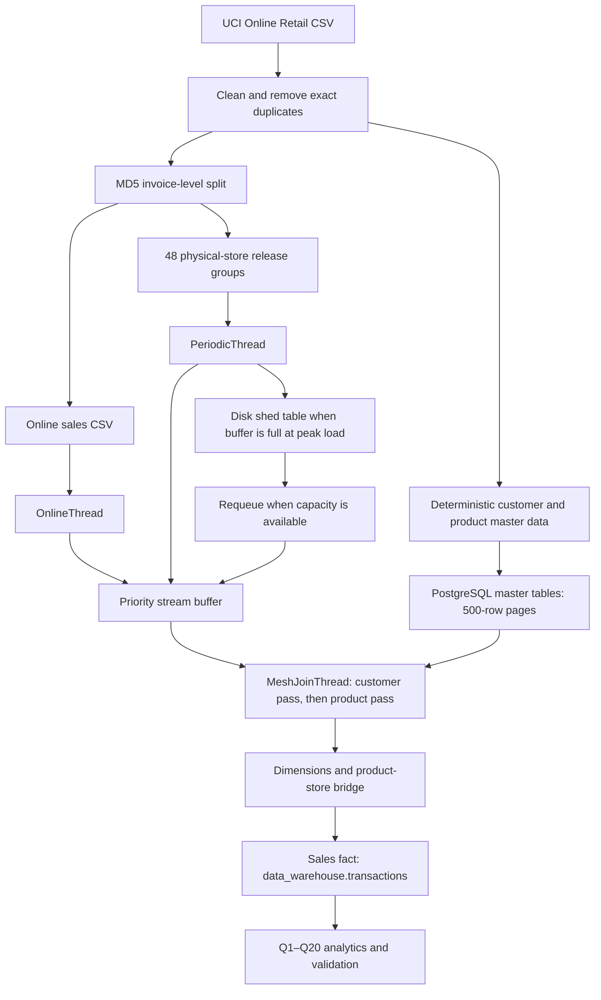

# Near-Real-Time and Periodic Data Warehouse for a Retail Chain

**Data Warehousing & Business Intelligence (DS3003/DS3004) · Fall 2026 · FAST–NUCES**  
**Ibrahim Hussain · 23I-2626**

This project builds a PostgreSQL retail data warehouse that handles two sales flows from the same dataset: **online purchases**, processed as a near-real-time stream, and **physical-store purchases**, released in periodic batches. A Python implementation of **MESHJOIN** enriches both flows using customer and product master data before loading a single sales fact table. Twenty SQL analyses cover customers, products, suppliers, stores, time trends, and shopping-cart patterns.

The main implementation is the **command-line ETL pipeline**. The available `app.py` is an earlier telecom-dashboard reference; it is **not** connected to this retail warehouse. See [Dashboard status](#dashboard-status).

## 1. What the project does

- Cleans the UCI Online Retail transaction file, removes cancelled/invalid sales and exact duplicate rows.
- Assigns every shopping cart to online or physical-store sales using a deterministic MD5 rule.
- Generates reproducible customer demographics, product categories, and supplier assignments.
- Loads online transactions, 48 scheduled physical-store groups, and master data into PostgreSQL.
- Runs three independent threads: `OnlineThread`, `PeriodicThread`, and `MeshJoinThread`.
- Implements a disk-paged MESHJOIN with **500-tuple master pages**, **500-transaction stream chunks**, and a **1,000-transaction priority buffer**.
- Prioritizes **online > periodic > previously shed** sales; only periodic sales may be written to the disk-backed shed table.
- Loads enriched results into a star schema and supports **20 OLAP queries (Q1–Q20)**.

### Pipeline



## 2. Repository layout

The relevant project files and generated outputs are organized as follows. Generated CSVs appear after the preparation step; the SQL/report deliverables may need to be copied into the repository root from the submission package.

```text
.
├── README.md
├── app.py                         # Existing telecom dashboard reference (not DW-connected)
├── .env                           # Local runtime settings; never commit credentials
├── Queries-DW.sql                 # All 20 retail OLAP queries
├── Run-Checks.sql                 # Database and ETL verification queries
├── DWBI_Project_Report.tex        # Two-page report source
├── DWBI_Project_Report.pdf        # Compiled project report
├── data/
│   ├── raw/
│   │   └── online-retail.csv      # UCI source converted to CSV
│   ├── static/
│   │   ├── clean_data.py          # Validate and deduplicate source data
│   │   ├── data_split.py          # Deterministic split into online / periodic
│   │   ├── feed_db.py             # End-to-end preparation and DB staging loader
│   │   ├── processed-retail.csv   # Generated cleaned dataset
│   │   ├── online.csv             # Generated online processing file
│   │   ├── periodical.csv         # Generated periodic groups
│   │   ├── online_sales_stream.csv  # Generated online submission file
│   │   ├── customer_master_data.csv # Generated customer master
│   │   └── product_master_data.csv  # Generated product master
│   └── dynamic/                   # Working/runtime data, if used
└── src/
    ├── warehouse-schema.sql      # PostgreSQL schemas, keys, checks and indexes
    ├── data_enrichment.py        # Three-thread interactive CLI entry point
    └── meshjoin/
        ├── base.py               # Runtime configuration and database connection
        ├── master_data.py        # Cyclic, disk-backed master-data paging
        ├── stream_buffer.py      # Bounded, source-priority queue
        ├── streamer.py           # Online, periodic and shed-queue producers
        └── mesh_join.py          # MESHJOIN passes and warehouse loader
```

## 3. Requirements

- **Python 3.10+**
- **PostgreSQL** and the `psql` command-line client
- A PostgreSQL account permitted to create a database and schemas
- Python database driver: `psycopg` (recommended), or `psycopg2`
- UCI **Online Retail** dataset in the expected CSV format

Run all commands below **from the repository root**. In a terminal:

```bash
python -m venv .venv
```

Activate the environment:

```powershell
# Windows PowerShell
.venv\Scripts\Activate.ps1
```

```bash
# Linux / macOS
source .venv/bin/activate
```

Install the PostgreSQL driver:

```bash
python -m pip install --upgrade pip
python -m pip install "psycopg[binary]"
```

The core cleaning and splitting scripts otherwise use the Python standard library. The older Streamlit reference dashboard has separate requirements and is not needed to operate the warehouse.

## 4. Initial setup and first run

### Step 1 — Obtain the raw data

Download **Online Retail** from the [UCI Machine Learning Repository](https://archive.ics.uci.edu/dataset/352/online+retail). The original source is an Excel workbook; convert it to a CSV preserving these column names:

`InvoiceNo`, `StockCode`, `Description`, `Quantity`, `InvoiceDate`, `UnitPrice`, `CustomerID`, `Country`.

Place the CSV at:

```text
data/raw/online-retail.csv
```

The processing scripts expect dates in `DD/MM/YYYY HH:MM` format. Do not hand-clean the file first: the preparation code performs the required checks and prints the counts.

### Step 2 — Create the database and tables

Start PostgreSQL and create the database once:

```bash
psql -U postgres -c "CREATE DATABASE realtime_data_stream;"
```

Create the operational, staging, waiting, and warehouse schemas:

```bash
psql -U postgres -d realtime_data_stream -v ON_ERROR_STOP=1 -f src/warehouse-schema.sql
```

> **Important:** `warehouse-schema.sql` starts by dropping the project schemas with `CASCADE`. **Running it again deletes previously loaded project data**, including facts and shed records. Run this step only on a new database or when intentionally resetting a test run.

### Step 3 — Clean, split, generate master data, and stage the inputs

The feeder runs the cleaning and splitting scripts, writes all required CSVs, and loads the online, periodic, customer-master, and product-master input tables:

```bash
python data/static/feed_db.py --database realtime_data_stream --user postgres
```

It prompts for any connection values not supplied (`host`, `port`, `database`, `user`) and securely prompts for the database password. To prepare CSV files without writing to PostgreSQL:

```bash
python data/static/feed_db.py --skip-db
```

The two stages can also be run separately when inspecting the output:

```bash
python data/static/clean_data.py
python data/static/data_split.py
```

These two standalone commands do **not** generate/load the master-data tables; use `feed_db.py` for the complete preparation step. Preparing inputs again truncates/reloads the staging tables and can reset shed-related records. Avoid doing this during an active run.

### Step 4 — Configure the runtime

Create a `.env` file **in the repository root** containing:

```dotenv
PGHOST=localhost
PGPORT=5432
PGDATABASE=realtime_data_stream
PGUSER=postgres
PGPASSWORD=YOUR_LOCAL_DATABASE_PASSWORD
ONLINE_SALES_FILE=data/static/online_sales_stream.csv

MD_PARTITION_SIZE=500
STREAM_CHUNK_SIZE=500
STREAM_BUFFER_LIMIT=1000
PEAK_RATE=80
NON_PEAK_RATE=10
SIMULATED_HOUR_SECONDS=60
NUM_PERIODIC_GROUPS=48
```

The values above match the assignment defaults. The ETL entry point reads the environment or `.env`; **unlike `feed_db.py`, it does not prompt interactively for credentials**. Keep `.env` and database passwords out of Git.

### Step 5 — Start the warehouse loader

```bash
python src/data_enrichment.py --arrival-mode peak
```

For a non-peak demonstration instead:

```bash
python src/data_enrichment.py --arrival-mode non-peak
```

The program prints the configured rates, simulated-hour length, stream-buffer capacity, input file, and customer/product master partition counts. It then starts the online producer, periodic producer, and MESHJOIN worker.

For execution without the interactive prompt (e.g., under an external controller):

```bash
python src/data_enrichment.py --arrival-mode peak --no-console
```

## 5. Interactive CLI commands

Enter these commands after the application starts:

| Command | Effect |
|---|---|
| `online` | Allow online-source arrivals; pause periodic-source arrivals. |
| `periodic` | Allow periodic-source arrivals; pause online-source arrivals. |
| `both` | Allow both source producers (default). |
| `peak` | Use the configured peak online arrival rate (default **80 rows/s**). |
| `non-peak` | Use the configured non-peak online rate (default **10 rows/s**) and permit shed-data recovery when buffer capacity is available. |
| `status` | Print source/rate mode, buffer occupancy, active hash entries, shed backlog, input counts and committed warehouse count. |
| `quit` | Request shutdown and flush staged fact rows. |

Example demonstration sequence:

```text
> status
> both
> peak
> status
> non-peak
> status
> quit
```

**Scheduling:** The periodic producer releases one of 48 ordered groups per **60-second simulated hour**; the first group may be released at startup. Online rows are read continuously from CSV at the selected rate. During peak overload, only periodic rows can be shed to `waiting_area.shed_table_physical` and later reintroduced at lower load. Online rows have highest priority. The CLI `status` values are live counters, not fixed final dataset totals.

## 6. Warehouse design

| Schema | Main objects | Purpose |
|---|---|---|
| `oltp_online` | `online_sales_stream` | Online source records. |
| `oltp_physical` | `periodic_sales_data` | Physical-store staging, release group and `released` flag. |
| `staging_area` | `customer_master`, `product_master`, `store_list` | Disk-resident enrichment data and store metadata. |
| `waiting_area` | `shed_table_physical`, `shed_table` view | Persistent overload queue for **periodic only** records. |
| `data_warehouse` | `transactions`, `dim_customer`, `dim_product`, `dim_supplier`, `dim_store`, `dim_time`, `products_store` | Sales star schema and product–store bridge. |

The warehouse **fact grain is one product line in a shopping cart**. `data_warehouse.transactions` is the **only physical fact table**; `data_warehouse.fact_sales` is a compatibility **view**, not a second copy of the sales. Its measure is `revenue = quantity * unit_price`. The fact retains the invoice/cart ID, five dimension keys, the product–store bridge key, transaction timestamp, `sales_mode`, and `processing_mode` (`Immediate` or `Shed`).

MESHJOIN scans the customer and product master tables from PostgreSQL in 500-row pages, instead of loading those tables entirely into a Python lookup dictionary. Enrichment happens in the **customer pass** and **product pass**; the small store list is joined separately. A row is written to the fact table **after** enrichment and dimension/bridge creation.

### Sales assignment rules

For the UTF-8 invoice ID as a string:

```python
from hashlib import md5

h = int(md5(transaction_id.encode("utf-8")).hexdigest()[:8], 16)
online = (h % 10) <= 6
store_id = 1 if online else 2 + (h % 4)
```

This applies to the **whole invoice**, not independently to each invoice line. Customer and product attributes are generated with similarly fixed MD5 rules, so repeated IDs receive stable values rather than random assignments. Online transactions use `sales_mode = TRUE`; physical-store transactions use `FALSE`.

**Live-result loading choice:** the optional live-result cache bonus is **not used**. After enrichment, online and periodic results are inserted **directly into `data_warehouse.transactions`**, in committed batches. The shed table holds overloaded *input* periodic records; it is not a cache of enriched online results.

## 7. Data-preparation results

The earlier project preparation run recorded the following counts:

| Measure | Rows |
|---|---:|
| Input rows | 541,909 |
| Passed validation rules | 397,884 |
| Exact duplicates removed | 5,192 |
| Final cleaned rows | **392,692** |
| Online rows | 275,154 |
| Periodic rows | 117,538 |
| Periodic release groups | 48 |
| Smallest / largest release group | 2,448 / 2,449 |

Cleaning removes invoices beginning with `C`, rows with missing customer IDs, nonpositive quantities/prices, and then exact duplicate rows. The 48 periodic release groups are time-ordered and balanced. These are **preparation-stage counts**, not evidence that every record has completed MESHJOIN and reached the fact table; use the verification queries after a full load.

## 8. Run the 20 analytics queries

After loading warehouse facts, execute the supplied PostgreSQL script:

```bash
psql -U postgres -d realtime_data_stream -v ON_ERROR_STOP=1 -f Queries-DW.sql
```

| Query | Analysis | Query | Analysis |
|---|---|---|---|
| Q1 | Top products by weekday/weekend, monthly drill-down | Q11 | Top products within each month and day type |
| Q2 | Sales by gender, age and city category | Q12 | Quarter-over-quarter store growth |
| Q3 | Product-category sales by occupation | Q13 | Supplier contribution by store and product |
| Q4 | Gender/age quarterly purchase trends | Q14 | Product performance by season |
| Q5 | Top occupations per product category | Q15 | Store–supplier monthly revenue volatility |
| Q6 | City/marital-status sales, latest six months | Q16 | Five most frequent product pairs per cart |
| Q7 | Average purchases by city-stay length and gender | Q17 | Yearly revenue `ROLLUP` and subtotals |
| Q8 | City-category revenue ranking by product category | Q18 | Product units/revenue by half-year |
| Q9 | Month-over-month category sales growth | Q19 | Product days exceeding 2× average daily revenue |
| Q10 | Weekend vs weekday sales by age group | Q20 | `STORE_QUARTERLY_SALES` view |

The analysis uses the **latest year loaded** where a query requires an annual period. Q20 also creates `data_warehouse.store_quarterly_sales_mv`, a materialized snapshot. To read the requested quarterly store view:

```sql
SELECT store_name, year, quarter, total_quarterly_sales
FROM data_warehouse.store_quarterly_sales
ORDER BY store_name, year, quarter;
```

After additional warehouse loads, refresh the **materialized snapshot** separately:

```sql
REFRESH MATERIALIZED VIEW data_warehouse.store_quarterly_sales_mv;
```

The normal Q20 **view** always reflects the underlying fact data; the materialized snapshot does not update until refreshed.

## 9. Validation and troubleshooting

Check master-data partition counts, periodic-group sizes, warehouse rows, and shed/recovered totals:

```bash
psql -U postgres -d realtime_data_stream -v ON_ERROR_STOP=1 -f Run-Checks.sql
```

For a quick manual check:

```sql
SELECT COUNT(*) AS loaded_rows FROM data_warehouse.transactions;
SELECT COUNT(*) AS pending_shed_rows
FROM waiting_area.shed_table_physical
WHERE processed = FALSE;
SELECT COUNT(*) AS unreleased_periodic_rows
FROM oltp_physical.periodic_sales_data
WHERE released = FALSE;
```

**Interpreting results:**

- **Zero fact rows:** Confirm that `feed_db.py` staged customer/product master data, `.env` points to the correct database and online CSV, and the MESHJOIN worker has been running long enough to complete both passes. Check `status` and the printed thread errors.
- **Missing master data:** Rerun preparation only on a fresh/reset run; `staging_area.customer_master` and `staging_area.product_master` must not be empty.
- **Rows in the shed queue:** Switch to `non-peak` and `both`, then check whether pending shed rows decrease. Previously shed rows are processed after online and regular periodic rows.
- **Partial totals:** The online stream is rate-limited and periodic groups are time-gated. A short demonstration or early shutdown will not load the full cleaned dataset.
- **Replaying data:** The fact table is append-oriented and the loader does not enforce a unique key per source invoice line. Re-running an already ingested online CSV can duplicate facts. For a clean replay, deliberately reset the test schema, rerun preparation, and then restart ETL.
- **Peak vs non-peak evidence:** The current schema records shed/recovery timestamps, but **not the active rate mode** at those moments. Capture `status` output and mode changes separately when documenting peak and non-peak results; do not infer exact per-mode counts from timestamps alone.

## 10. Dashboard status

`app.py` in the available repository snapshot contains a **Streamlit telecom-churn dashboard** used as a visual reference. It still reads telecom CSV data and does not expose this project's PostgreSQL tables or MESHJOIN CLI controls. Therefore, this README uses `src/data_enrichment.py` as the warehouse's supported operational entry point. A future retail dashboard can present the database load progress, thread state, shed recovery, and Q1–Q20 results without changing the core ETL pipeline.

## 11. Submission material and reproducibility

The assignment's deliverables map to the following files:

| Submission component | Source in this project |
|---|---|
| Create-DW | `src/warehouse-schema.sql` |
| Mesh-Join | `src/data_enrichment.py`, `src/meshjoin/`, `data/static/*.py` |
| Queries-DW | `Queries-DW.sql` |
| Data | `data/static/online_sales_stream.csv`, `customer_master_data.csv`, `product_master_data.csv` |
| Project-Report | `DWBI_Project_Report.pdf` and `DWBI_Project_Report.tex` |
| ReadMe | This `README.md` |

Include the requested **data-source note** alongside the CSV files, stating the original download date and documenting the cleaning/splitting rules and recorded counts. The source download date was **not available in the reviewed project records** and must be filled in from the original download history rather than guessed. The report also identifies which runtime measurements still require a completed local database run.

**Data source:** Chen, D., Sain, S. L., and Guo, K. *Online Retail*. UCI Machine Learning Repository. https://archive.ics.uci.edu/dataset/352/online+retail. Source transactions span **1 December 2010 to 9 December 2011**.

**Security:** Do not commit `.env`, passwords, virtual environments, local PostgreSQL data directories, or other machine-specific credentials. Use a local/test database for schema rebuilds and streaming demonstrations.
